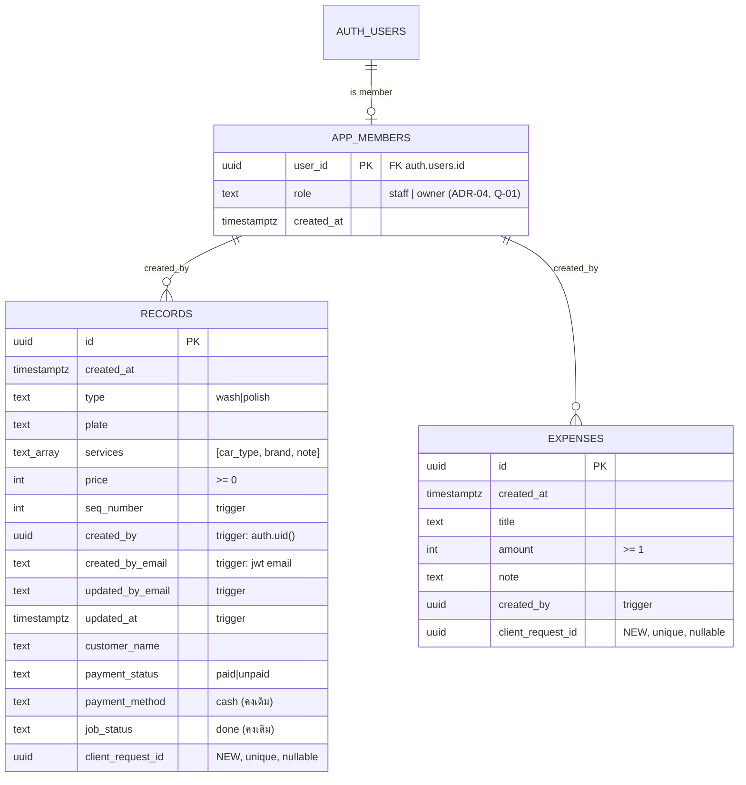

# Database Schema — Step 05

> วันที่: 2026-10-14 · **ยังไม่ได้เห็น schema จริงของ Production** (S01-01) ดังนั้นทุกอย่างใน §1 อนุมานจากโค้ด [I] และต้องยืนยันด้วย SQL ใน `production-baseline.md` §8 ก่อนเขียน migration จริง (`database-migration-plan.md` M000)
> SQL ในเอกสารนี้เป็น **แบบร่างเพื่อ review** ยังไม่ได้รันกับฐานข้อมูลใดเลย และห้ามรันกับ Production

## 1. Schema ปัจจุบัน (อนุมาน)

### 1.1 `public.records` — รายรับ

| Column | Type [I] | Null [I] | ใช้โดย [V] | หมายเหตุ |
|---|---|---|---|---|
| `id` | uuid (default `gen_random_uuid()`) | no | ทุกที่ | PK [I] |
| `created_at` | timestamptz | no | ทุก query | **client กำหนดค่าเอง** (`generateTimestamp`) และแก้ได้ |
| `type` | text | no | `'wash' \| 'polish'` | ไม่รู้ว่ามี check constraint หรือไม่ [U] |
| `plate` | text | no | ค้นหา, นับลูกค้าประจำ | upper-case จาก client |
| `services` | text[] | ? | `[ประเภทรถ, ยี่ห้อ, หมายเหตุ]` ตามตำแหน่ง | TD-06 |
| `price` | integer? numeric? | no | รวมยอด | [U] ชนิดจริง |
| `seq_number` | integer | ? | แสดง `#n` | client คำนวณ (ER-04) |
| `created_by` | uuid | ? | — | จาก client |
| `created_by_email` | text | ? | แสดง "เพิ่มโดย" | จาก client (ER-14) |
| `updated_by_email` | text | ? | แสดง "แก้ไขโดย" | จาก client |
| `updated_at` | timestamptz | ? | แสดงเวลาแก้ไข | จาก client |
| `payment_method` | text | ? | insert `'cash'` เสมอ | D-15 คงไว้ |
| `customer_name` | text | yes | จัดกลุ่มหนี้ / ลูกค้า | ว่าง, NULL หรือมีช่องว่างได้ (ER-03) |
| `payment_status` | text | no | `'paid' \| 'unpaid'` | |
| `job_status` | text | ? | insert `'done'` เสมอ | D-15 คงไว้ |
| `note` | text | yes | **ไม่มีโค้ดเขียน** (หมายเหตุอยู่ใน `services[2]`) | [U] มี column จริงหรือไม่ |

### 1.2 `public.expenses` — รายจ่าย

| Column | Type [I] | Null [I] | หมายเหตุ |
|---|---|---|---|
| `id` | uuid | no | PK |
| `created_at` | timestamptz | no | client กำหนด |
| `title` | text | no | |
| `amount` | integer? | no | ≥ 1 ตาม Zod |
| `note` | text | yes | |
| `created_by`, `created_by_email`, `updated_by_email`, `updated_at` | | | จาก client |

### 1.3 อื่น ๆ
- Realtime publication: ใช้กับ `records`, `expenses` [V โค้ด] / [U config]
- RLS, policies, indexes, triggers, functions: **[U] ทั้งหมด**
- Storage: ไม่ใช้ [V]

## 2. Target Schema

หลักการ: **expand-only สำหรับ MVP** ไม่ลบหรือเปลี่ยนชนิด column เดิม และไม่ rename ทุกอย่างที่เพิ่มต้อง backward-compatible กับ client v1.0.0 (`database-migration-plan.md` §3)

### 2.1 ERD (Target MVP)



> ไม่มี FK จริงจาก `records.created_by` → `app_members` ใน MVP เพราะข้อมูลเก่าอาจมีค่า null หรือ user ที่ถูกลบ (ใช้ trigger กำหนดค่าใหม่เท่านั้น)

### 2.2 Objects ใหม่

#### `public.app_members` (ADR-04)
```sql
create table public.app_members (
  user_id    uuid primary key references auth.users(id) on delete cascade,
  role       text not null default 'staff' check (role in ('staff','owner')),
  created_at timestamptz not null default now()
);
alter table public.app_members enable row level security;
-- ไม่มี policy ให้ authenticated เขียน (จัดการโดยผู้ดูแลผ่าน SQL Editor)
create policy app_members_read_self on public.app_members
  for select to authenticated using (user_id = auth.uid());

create or replace function public.is_app_member() returns boolean
  language sql stable security definer set search_path = '' as $$
  select exists (select 1 from public.app_members m where m.user_id = auth.uid());
$$;
revoke all on function public.is_app_member() from public, anon;
grant execute on function public.is_app_member() to authenticated;
```

#### Columns ใหม่ (nullable ทั้งหมด)
```sql
alter table public.records  add column if not exists client_request_id uuid;
alter table public.expenses add column if not exists client_request_id uuid;
create unique index if not exists records_client_request_id_key  on public.records  (client_request_id) where client_request_id is not null;
create unique index if not exists expenses_client_request_id_key on public.expenses (client_request_id) where client_request_id is not null;
```

#### Constraints (เพิ่มแบบ `NOT VALID` ก่อน แล้ว `VALIDATE` หลังตรวจข้อมูลเก่า)
| Constraint | เงื่อนไข | ที่มา |
|---|---|---|
| `records_type_chk` | `type in ('wash','polish')` | FR-REC-01 |
| `records_payment_status_chk` | `payment_status in ('paid','unpaid')` | |
| `records_plate_len_chk` | `char_length(btrim(plate)) between 1 and 20` | FR-REC-02 |
| `records_price_chk` | `price >= 0` | FR-REC-02 |
| `records_customer_len_chk` | `customer_name is null or char_length(customer_name) <= 50` | FR-REC-02 |
| `records_services_len_chk` | `services is null or coalesce(char_length(services[3]),0) <= 200` | หมายเหตุ ≤ 200 (PostgreSQL array index เริ่มที่ 1) |
| `expenses_amount_chk` | `amount >= 1` | FR-REC-03 |
| `expenses_title_len_chk` | `char_length(btrim(title)) between 1 and 100` | FR-REC-03 |
| `expenses_note_len_chk` | `note is null or char_length(note) <= 200` | FR-REC-03 |

> ⚠ ถ้าข้อมูลเก่ามีแถวที่ผิดกติกา (เช่น ราคา 0 ไม่ผิด แต่ทะเบียนว่างจาก EditModal ER-05) `VALIDATE` จะ fail ต้องตรวจก่อนบน staging (SQL ใน migration plan §4) และ **ห้ามแก้ข้อมูลอัตโนมัติ** โดยให้เจ้าของตัดสินรายแถว

#### Triggers
```sql
-- Audit fields: ค่าจาก client ถูกแทนที่เสมอ (ER-14)
create or replace function public.tg_set_audit() returns trigger
  language plpgsql security invoker set search_path = '' as $$
begin
  if tg_op = 'INSERT' then
    new.created_by       := auth.uid();
    new.created_by_email := auth.jwt() ->> 'email';
    new.updated_at       := null;
    new.updated_by_email := null;
  else
    new.created_by       := old.created_by;        -- แก้ไม่ได้
    new.created_by_email := old.created_by_email;
    new.updated_at       := now();
    new.updated_by_email := auth.jwt() ->> 'email';
  end if;
  return new;
end $$;

-- seq_number: max+1 ต่อวัน (Asia/Bangkok) กันซ้ำด้วย advisory lock (ER-04, Q-06)
create or replace function public.tg_set_seq_number() returns trigger
  language plpgsql security invoker set search_path = '' as $$
declare d date := (new.created_at at time zone 'Asia/Bangkok')::date;
begin
  perform pg_advisory_xact_lock(hashtext('records_seq_' || d::text));
  select coalesce(max(seq_number), 0) + 1 into new.seq_number
    from public.records
   where (created_at at time zone 'Asia/Bangkok')::date = d;
  return new;
end $$;

create trigger records_audit  before insert or update on public.records  for each row execute function public.tg_set_audit();
create trigger expenses_audit before insert or update on public.expenses for each row execute function public.tg_set_audit();
create trigger records_seq    before insert            on public.records  for each row execute function public.tg_set_seq_number();
```
> ทั้งสอง trigger เป็น `security invoker` (สิทธิ์ของผู้ใช้ที่ทำรายการ) เพราะ `auth.uid()`/`auth.jwt()` ใช้ได้ในสิทธิ์ `authenticated` อยู่แล้ว และ `tg_set_seq_number` อ่าน `records` ภายใต้ RLS ซึ่งสมาชิกทุกคนอ่านได้ทั้งหมด (ADR-04)
> `tg_set_audit` ทำงานกับ `settle_records` ด้วย จึงบันทึกผู้เคลียร์ยอดและเวลาให้อัตโนมัติ
> ถ้าคง `seq_number` แบบเดิมตาม Q-06 ให้ข้าม `records_seq` (ER-04 ยังอยู่)

#### Indexes
| Index | เพื่อ |
|---|---|
| `records (created_at)` | today, เดือน, ปี, กราฟ |
| `records (created_at) where payment_status = 'unpaid'` | สมุดทวงหนี้ |
| `records (plate)` | ลูกค้าประจำ (FR-REC-06) |
| `expenses (created_at)` | today, เดือน |
| `records (client_request_id)`, `expenses (client_request_id)` partial unique | idempotency |

ตารางมีขนาดเล็ก (หลักพันถึงหมื่นแถว [I], U-5) จึงสร้าง index แบบปกติใน migration (lock สั้น) ไม่ต้อง `concurrently` (ซึ่งรันใน transaction ไม่ได้)

#### Functions (RPC) — `security invoker` เพื่อให้ RLS มีผล
| Function | คืนค่า | ใช้ที่ |
|---|---|---|
| `settle_records(p_ids uuid[])` | `(updated_count int, total int)` | เคลียร์ยอด (เฉพาะ id ที่ผู้ใช้เห็นและยืนยัน) |
| `dashboard_today(p_day date default (now() at time zone 'Asia/Bangkok')::date)` | `(total_income, paid_income, unpaid_income, expense, wash_count, polish_count, yesterday_income)` | MoneyHero |
| `daily_series(p_from date, p_to date)` | `setof (day date, income int, expense int)` | กราฟ 7/30 วัน |
| `debt_summary()` | `(customer_key text, display_name text, items int, total int, oldest timestamptz)` | badge, การ์ดค้างชำระ |
| `customer_breakdown(p_ref date)` | `setof (customer_key, period, wash_count, wash_amount, polish_count, polish_amount, total)` | รายรับตามลูกค้า |
| `period_summary(p_from date, p_to date)` | `(income, expense, wash_count, wash_amount, polish_count, polish_amount, record_count, expense_count)` | History, ตรวจ export |

ตัวอย่าง:
```sql
create or replace function public.settle_records(p_ids uuid[])
returns table (updated_count int, total int)
language sql security invoker set search_path = '' as $$
  with u as (
    update public.records set payment_status = 'paid'
     where id = any(p_ids) and payment_status = 'unpaid'
    returning price
  )
  select count(*)::int, coalesce(sum(price), 0)::int from u;
$$;
revoke all on function public.settle_records(uuid[]) from public, anon;
grant execute on function public.settle_records(uuid[]) to authenticated;
```
`customer_key` = `coalesce(nullif(btrim(customer_name), ''), '')` โดย `''` แสดงเป็น "ลูกค้าทั่วไป" (แก้ ER-03 ระดับการจัดกลุ่ม)

### 2.3 Decision-gated objects (สร้างเมื่อเจ้าของตอบ)

| คำถาม | Objects | สรุป |
|---|---|---|
| Q-02 = b/c (กู้คืนการลบได้) | `records.deleted_at`, `expenses.deleted_at`, RLS `using (deleted_at is null)`, RPC `soft_delete_record`, `restore_record`, `pg_cron` purge หลัง N วัน | ⚠ client v1.0.0 ใช้ hard delete จึงต้อง revoke `delete` หลัง client ใหม่ใช้งานครบ (contract phase) |
| Q-05 = b (เลขบิลกลาง) | `bills (id, bill_no bigint unique, customer_key, record_ids uuid[], total, issued_by, issued_at)`, sequence `bill_no_seq start with <max เดิม + 1>`, RPC `issue_bill(p_customer, p_ids)` | เลขเดิมอยู่ใน localStorage ของแต่ละเครื่อง จึงต้องให้เจ้าของบอกเลขล่าสุด |
| Q-13 = b (audit log เต็ม) | `audit_log (id, table_name, row_id, action, changed_by, changed_at, old jsonb, new jsonb)` + trigger after insert/update/delete | ขนาดข้อมูลโตเร็วกว่าตารางหลัก |
| Q-01 = b (2 roles) | ใช้ `app_members.role` + policy แยก (`authorization-matrix.md` §3) | ไม่ต้องเพิ่มตาราง |
| ADR-09 (post-MVP) | `records.car_type text`, `records.car_brand text`, `records.note_text text` + backfill จาก `services` | contract `services` เฉพาะหลังทุก client ใช้ column ใหม่ |

## 3. TypeScript Types & Validation Schemas (Task 5)

### 3.1 Generated DB types
`types/database.ts` สร้างจาก `supabase gen types typescript --project-id <staging>` (Supabase CLI ใช้ใน CI/เครื่อง dev และไม่เป็น runtime dependency) และ commit ไว้ใน repo · CI ตรวจว่า type ตรงกับ migration ล่าสุด (`ci-quality-gates` ใน Step 06)

### 3.2 Domain types (`features/*/types.ts`)
```ts
export type JobType = 'wash' | 'polish'
export type PaymentStatus = 'paid' | 'unpaid'
export interface IncomeRecord {
  id: string; createdAt: string /* ISO */; job: JobType; plate: string
  carType: string | null; brand: string | null; note: string | null   // จาก services[] (mapper)
  price: number; seq: number; customerName: string | null; paymentStatus: PaymentStatus
  createdByEmail: string | null; updatedByEmail: string | null; updatedAt: string | null
}
export interface ExpenseRecord { id: string; createdAt: string; title: string; amount: number; note: string | null; createdByEmail: string | null; updatedByEmail: string | null; updatedAt: string | null }
export interface DebtGroup { customerKey: string; displayName: string; items: IncomeRecord[]; total: number; oldestDays: number }
```
ตั้งชื่อ `IncomeRecord` แทน `Record` เพื่อไม่ชนกับ `Record<K,V>` ของ TS (TD-07)

### 3.3 Zod schemas (`features/records/schema.ts`) — กฎเดียวกับ DB constraint
```ts
export const incomeInput = z.object({
  job: z.enum(['wash', 'polish']),
  plate: z.string().trim().min(1, 'กรุณากรอกป้ายทะเบียน').max(20, 'ป้ายทะเบียนยาวเกิน 20 ตัวอักษร').transform(s => s.toUpperCase()),
  carType: z.string().min(1, 'กรุณาเลือกประเภทรถ'),
  brand: z.string().optional(),
  price: z.number({ error: 'กรุณากรอกราคา' }).int().min(0),
  paymentStatus: z.enum(['paid', 'unpaid']),
  customerName: z.string().trim().max(50, 'ชื่อยาวเกิน 50 ตัวอักษร').optional(),
  note: z.string().trim().max(200, 'หมายเหตุยาวเกิน 200 ตัวอักษร').optional(),
  occurredOn: z.string().regex(/^\d{4}-\d{2}-\d{2}$/),          // วันที่ (เวลาไทย)
  clientRequestId: z.uuid(),
})
export const expenseInput = z.object({
  amount: z.number({ error: 'กรุณากรอกจำนวนเงิน' }).int().min(1, 'กรุณากรอกจำนวนเงินมากกว่า 0'),
  title: z.string().trim().min(1, 'กรุณาระบุรายการจ่าย').max(100, 'รายการยาวเกิน 100 ตัวอักษร'),
  note: z.string().trim().max(200).optional(),
  occurredOn: z.string().regex(/^\d{4}-\d{2}-\d{2}$/),
  clientRequestId: z.uuid(),
})
export const incomePatch = incomeInput.omit({ clientRequestId: true, occurredOn: true })
  .extend({ occurredAt: z.iso.datetime({ offset: true }) }).partial()   // ส่งเฉพาะ field ที่เปลี่ยน
```
ข้อความ error คงตามเดิม (`app/add/page.tsx:70-76, 125-129`) และ zod v4 [V `package.json` ^4.4.3]

## 4. ข้อมูลอ้างอิงที่ไม่ได้อยู่ใน DB
`CAR_TYPES` และ `CAR_BRANDS` คงเป็น constant ในโค้ด (`features/records/catalog.ts`) และไม่ย้ายเข้า DB ใน MVP (TD-05 P3)
