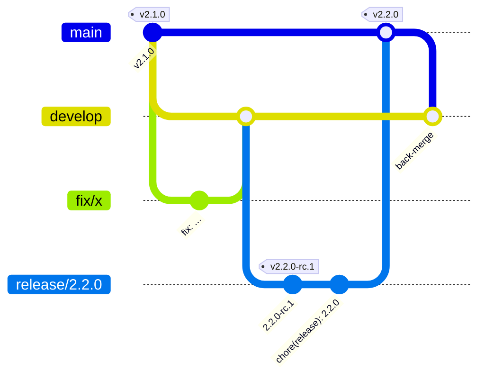

# Git Workflow & Release Guide

> อัปเดต Step 12 · 2026-10-20 · ใช้กับงานตั้งแต่ v2.1.0 · ป้าย: **[V]** Verified · **[I]** Inferred · **[U]** Unknown
> แผนเดิม (Step 06) อยู่ใน git history ของไฟล์นี้ · deploy และ rollback: `deployment-guide.md`, `rollback-plan.md` · checklist ต่อ release: `release-checklist.md`

## 1. หลักใหญ่

- **`main` = production** · ทุก merge ที่เปลี่ยนโค้ดเข้า `main` ทำให้ Vercel deploy production ทันที [V]
- **`develop` = ที่รวมงาน** · งานปกติทุกชนิดเข้า `develop` ไม่เข้า `main` (เจ้าของตัดสิน 2026-10-19, S10-01)
- `main` รับเฉพาะ `release/*` (merge commit) และ `hotfix/*` ที่เจ้าของอนุมัติ
- หลัง release หรือ hotfix ต้อง back-merge `main` → `develop`
- เลขเวอร์ชันใน `package.json` เปลี่ยนเฉพาะบน `release/*` และ `hotfix/*` · แอปแสดงเลขนี้ท้ายหน้า login และในหน้าเพิ่มเติม



## 2. Branches

| Branch | แตกจาก | Merge เข้า | วิธี merge | Vercel |
|---|---|---|---|---|
| `main` | — | — | — | **Production** |
| `develop` | — (ถาวร) | `release/*` | — | Preview |
| `feature/*`, `fix/*`, `perf/*`, `refactor/*`, `test/*`, `docs/*`, `chore/*`, `ci/*`, `db/*` | `develop` | `develop` | **Squash and merge** | Preview (docs-only ไม่ build) |
| `release/<x.y.z>` | `develop` | `main` แล้ว back-merge `develop` | **Create a merge commit** | Preview (RC) |
| `hotfix/<desc>` | `main` (commit ที่ production รันอยู่) | `main` แล้ว back-merge `develop` (+ `release/*` ที่เปิดอยู่) | Squash (หรือ merge commit ถ้ามีหลาย commit ที่ควรเก็บ) | Preview → Production |

ชื่อ branch: ตัวเล็ก ภาษาอังกฤษ คั่นด้วย `-` เช่น `fix/debt-card-when-nothing-owed`

## 3. งานปกติ

1. `git fetch origin && git status` → working tree สะอาด
2. `git switch -c fix/<desc> origin/develop`
3. commit ตาม Conventional Commits (`commit-conventions.md`) · `npm run validate` ก่อน push
4. `git push -u origin fix/<desc>` → Vercel สร้าง Preview (staging)
5. เปิด PR: **base `develop`** · title ตาม regex ของ CI (`development-guide.md` §6) · body ตาม template · บรรทัดแรกบอก SQL ที่ต้องรันบน production (ถ้ามี)
6. รอ CI ผ่านครบ · ตรวจ Preview
7. **Squash and merge** · ลบ branch

## 4. Release (develop → main)

| # | ขั้น | คำสั่ง / หลักฐาน |
|---|---|---|
| 1 | ตัด release branch จาก `develop` ที่ CI เขียว | `git switch -c release/2.2.0 origin/develop` |
| 2 | ตั้งเวอร์ชัน RC แล้ว commit | `npm version 2.2.0-rc.1 --no-git-tag-version` → commit `chore(release): 2.2.0-rc.1` → push |
| 3 | ตรวจ RC | CI · E2E ในเครื่อง (Chromium + WebKit) · `e2e-preview` บน Preview ของ commit นั้น (`testing-guide.md` §5) · ตรวจว่า Preview ใช้ staging |
| 4 | Tag RC เมื่อผ่าน | `git tag -a v2.2.0-rc.1 <sha> -m "…"` บน commit ที่ Preview ผ่าน → `git push origin v2.2.0-rc.1` · RC ที่ไม่ผ่านไม่ต้อง tag · แก้บน release branch แล้วเป็น rc.2 … |
| 5 | **ตั้งเวอร์ชันจริงก่อนเปิด PR** | `npm version 2.2.0 --no-git-tag-version` → commit `chore(release): 2.2.0` → push → รอ CI + Preview ขึ้น `v2.2.0` · ⚠ ถ้าข้ามขั้นนี้ production จะแสดงเลข rc (เกิดจริงใน v2.1.0, S11-01) |
| 6 | เอกสาร | release notes, readiness checklist, rollback target (`release-checklist.md`) |
| 7 | Migration (ถ้ามี) | backup → เจ้าของรันบน production **ก่อน** merge (`database-migrations.md` §3.2) |
| 8 | Release PR (เจ้าของเปิดและ merge) | ดูรูปแบบ §6 · **Create a merge commit** · นอกเวลาทำการ (Q-19) |
| 9 | ยืนยันสิ่งที่ขึ้นจริง | GitHub deployments ของ merge commit = `Production` + `success` (§7) · หน้า production ขึ้นเลขเวอร์ชันใหม่ |
| 10 | Smoke + เฝ้าระวัง | `smoke-test-results.md` และ `monitoring-report.md` เป็นแม่แบบ · ห้ามรายงานว่าสำเร็จก่อนตรวจจริง |
| 11 | Tag release | `git tag -a v2.2.0 <merge sha> -m "v2.2.0 — … (deployed to production YYYY-MM-DD)"` → push · บน commit ที่ production รันและแสดงเลขนั้นจริงเท่านั้น |
| 12 | Back-merge | ถ้า `develop` เป็นบรรพบุรุษของ `main`: `git push origin origin/main:refs/heads/develop` (fast-forward ไม่ใช่ force push) · ถ้าไม่ใช่: PR `main` → `develop` แบบ merge commit |
| 13 | บันทึก | `release-record.md` (แม่แบบจาก v2.1.0) |

## 5. Hotfix

1. `git switch -c hotfix/<desc> origin/main` (commit ที่ production รันอยู่ ตรวจด้วย §7)
2. test ที่ reproduce บั๊ก (ต้องล้มกับโค้ดเดิม) + แก้ + bump PATCH ใน `package.json`
3. PR → `main` (เจ้าของอนุมัติก่อน เพราะ deploy production ทันที) → CI → merge
4. ยืนยัน deployment → tag `vX.Y.(Z+1)` → back-merge `develop` และ `release/*` ที่เปิดอยู่
5. ตัวอย่าง: D-07 (PR #47) ทำเป็น hotfix และ merge เข้า release branch ที่เปิดอยู่ (`release-candidate-report.md`)

## 6. รูปแบบการส่ง PR ให้เจ้าของ

ทุกครั้งต้องบอก 4 อย่าง (เจ้าของขอใน Step 09):

```
base:    main            ← ปลายทาง
compare: release/2.2.0   ← ต้นทาง
title:   chore(release): 2.2.0
merge:   Create a merge commit   (งานปกติ = Squash and merge)
```

และบอกว่า merge แล้ว**ขึ้น production ทันทีหรือไม่** · ลิงก์ `https://github.com/kittiphat78/car-care-intelligence/compare/<base>...<compare>?expand=1&title=…&body=…` เปิด PR พร้อมกรอก title และ body ให้

## 7. ตรวจว่าอะไรขึ้น production

เลขเวอร์ชันบนหน้าจอไม่พอ (ก่อน v2.1.0 เคยขึ้น v2.0.0 ทั้งที่โค้ดใหม่กว่า) · ใช้ GitHub API (ไม่ต้อง login, จำกัด 60 ครั้ง/ชม. ต่อ IP):

```bash
curl -s "https://api.github.com/repos/kittiphat78/car-care-intelligence/deployments?environment=Production&per_page=3"   # sha ล่าสุด
curl -s "https://api.github.com/repos/kittiphat78/car-care-intelligence/deployments/<id>/statuses"                     # state = success
```

## 8. Vercel

| Branch | Deploy |
|---|---|
| `main` | Production อัตโนมัติ |
| อื่น ๆ ทุก branch | Preview (staging, ต้องผ่าน Vercel Authentication) |
| commit ที่แก้แค่ `docs/` | ไม่ build (Ignored Build Step) [V] |

## 9. Tag

- annotated เท่านั้น · release tag บน merge commit ที่ production รันจริง · RC tag บน commit ของ release branch ที่ผ่าน Preview
- ห้ามย้าย ลบ หรือสร้าง tag ย้อนหลัง · tag ผิดให้ออก PATCH ใหม่และบันทึก
- ประวัติ: `v1.0.0` (2026-09-28) → `v1.0.1` (10-14) → `v1.2.0` (10-16) → `v2.0.0-rc.1`, `v2.0.0` (10-18) → `v2.1.0-rc.4`, `v2.1.0` (10-19) · ไม่มี `v1.1.0` (รวมเข้า 1.2.0) และ `v0.5.0` [V]

## 10. ข้อห้าม

- commit/push ตรงเข้า `main` (ruleset บังคับ PR + 9 checks) [V]
- force push `main`, `develop`, `release/*` · แก้ประวัติที่ push แล้ว
- merge PR ที่ CI ไม่ผ่าน หรือข้าม ruleset (รวมตอน GitHub Actions ล่ม: รอ)
- `git reset --hard`, `git clean -fd`, `git stash drop` กับงานที่ยังไม่ commit โดยไม่ตรวจก่อน
- commit `.env*` · แก้ข้อมูล production เพื่อทดสอบ

## 11. งานค้าง

| เรื่อง | สถานะ |
|---|---|
| ruleset ของ `develop` (ต้องผ่าน CI ก่อน merge) | แนะนำ ยังไม่ตั้ง [V] |
| remote branch เก่าที่ merge แล้วราว 80 ตัว | ยังไม่ลบ (ต้องอนุมัติ, S06-03) |
| GitHub Release page ของแต่ละ tag | ไม่ได้สร้าง (ไม่บังคับ) |
