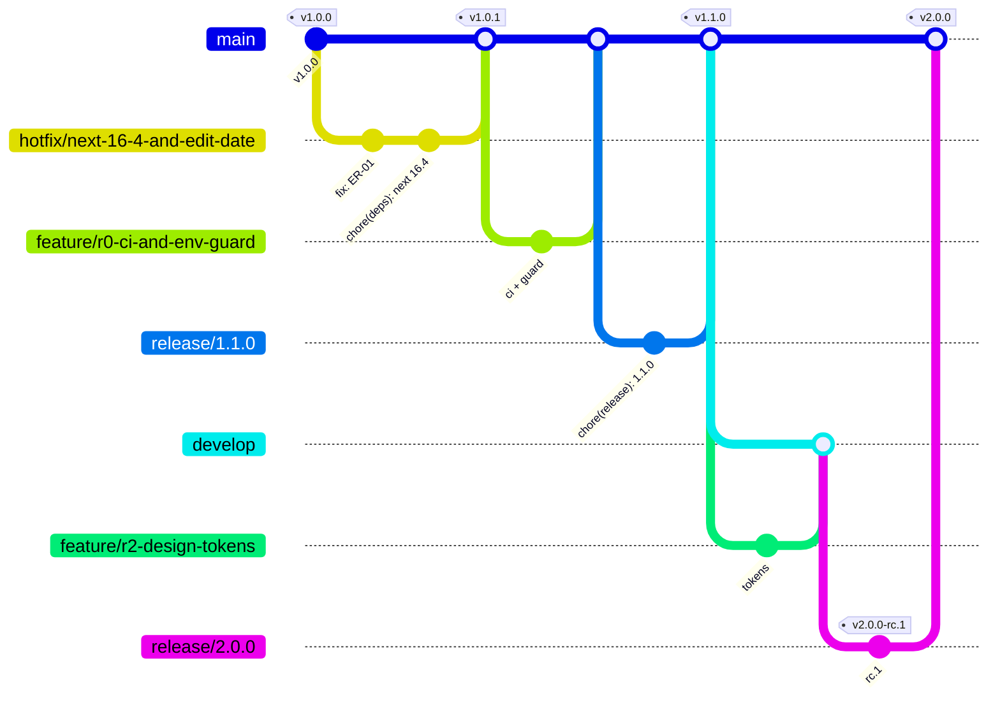

# Git Workflow — Step 06

> วันที่: 2026-10-14 · Branch: `docs/redesign-step-06-workflow`
> **Step นี้ไม่ได้สร้าง branch บน remote, tag หรือเปลี่ยน GitHub/Vercel settings** สิ่งที่สร้างมีแค่ branch เอกสารในเครื่อง
> ป้ายกำกับ: **[V]** Verified · **[I]** Inferred · **[U]** Unknown

## 1. สภาพปัจจุบัน (ตรวจแล้ว)

| เรื่อง | สถานะ | หลักฐาน |
|---|---|---|
| ทีม | นักพัฒนา 1 คน (git user `kittiphat78`) | [V] `git log` |
| การ merge | ส่วนใหญ่ merge ในเครื่องเข้า `main` (`merge: …`) และมี PR บน GitHub 1 ครั้ง (#1) | [V] `git log main --merges` |
| Commit message | Conventional Commits เป็นส่วนใหญ่ (feat 18, fix 13, style 10, refactor 5, chore 4) และมีนอกมาตรฐาน: `merge:`, `security:` | [V] 60 commit ล่าสุด |
| Remote branches | 28 ตัวนอกจาก `main` (merge แล้ว 27 และยังไม่ merge 1: `chore/performance-optimization`) | [V] `git branch -r --merged/--no-merged origin/main` |
| Local branches ที่ไม่ได้ push | 3 ตัว (S01-08) + docs 7 ตัว (Step 00–06) | [V] |
| Tags | `v0.2.0`, `v0.3.0`, `v0.4.0`, `v1.0.0` (annotated) และไม่มี `v0.5.0` แม้ commit message จะอ้างถึง | [V] |
| CI | ไม่มี `.github/` | [V] |
| Git hooks | ไม่มี (husky หรือ hooksPath) | [V] |
| Branch protection / rulesets | ตรวจไม่ได้ (ไม่มี `gh` และไม่มีสิทธิ์ API) | [U] S06-01 |
| Vercel production branch | น่าจะเป็น `main` | [I] (A2) |
| `develop` / `release/*` | ไม่มี | [V] |

## 2. Strategy ที่เลือก: "GitHub Flow + Release branches + develop เฉพาะช่วง redesign UI"

เหตุผล: ทีม 1 คนจึงไม่ต้องการ Git Flow เต็มรูปแบบ แต่ redesign UI (Phase B) ต้องรวมหลายหน้าและทดสอบร่วมกันบน Preview ก่อนปล่อย จึงต้องมีที่รวมงานที่ไม่ใช่ `main`

### 2.1 Branches

| Branch | มีอยู่ไหม | สร้างเมื่อ | แตกจาก | Merge เข้า | อายุ | Deploy (Vercel) |
|---|---|---|---|---|---|---|
| `main` | ✅ [V] | — | — | — | ถาวร | **Production** (อัตโนมัติ [I]) |
| `develop` | ❌ | **เริ่ม Phase B** (R2) | `main` @ tag ล่าสุด | `release/2.x` | ถึง v2.0.0 แล้วลบ (หรือคงไว้ถ้ามีงานใหญ่ต่อ) | Preview (staging) |
| `feature/<scope>-<desc>` | — | ต่องาน | `main` (Phase A) / `develop` (Phase B) | ที่มาเดิม | ≤ 1 สัปดาห์ † | Preview |
| `fix/<scope>-<desc>` | — | บั๊กที่ไม่ด่วน | เหมือน feature | เหมือน feature | สั้น | Preview |
| `hotfix/<desc>` | — | บั๊ก production ที่ต้องแก้ทันที | **`main` @ tag ที่ deploy อยู่** | `main` (+ back-merge `develop` ถ้ามี) | ชั่วโมงถึงวัน | Preview → Production |
| `release/<x.y.z>` | — | เตรียมปล่อย (bump version, release notes, RC) | `main` (Phase A) / `develop` (Phase B) | `main` (+ back-merge `develop`) | วันถึงสัปดาห์ | Preview (RC) |
| `docs/<desc>` | ✅ (ในเครื่อง) | เอกสาร | `main` | `main` | สั้น | ไม่ควร build (§5) |
| `chore/<desc>`, `ci/<desc>` | — | งานเครื่องมือ | `main` | `main` | สั้น | Preview |
| `archive/<ชื่อเดิม>` | — | เก็บงานที่ไม่ merge (S01-08) | — | ไม่ merge | ถาวร (read-only) | ไม่ deploy |

**ชื่อ branch:** ตัวพิมพ์เล็ก, `-` คั่นคำ, ภาษาอังกฤษ, scope จาก `commit-conventions.md` §3 เช่น `feature/r2-add-page-redesign`, `fix/debts-settle-null-customer`, `hotfix/edit-date-shift`

### 2.2 Phase ของงาน

| Phase | Releases | ลักษณะ | Branch model |
|---|---|---|---|
| **0 Hotfix** | v1.0.1 | Next 16.4.x + ER-01 (ถ้า Q-18 = a) | `hotfix/*` → `main` |
| **A Foundation & Data** | v1.1.0 (R0), v1.2.0 (R1) | CI, env guard, DB migrations (expand), RLS, data fixes บน **UI เดิม** | `feature/*` → `main` ผ่าน `release/*` |
| **B Redesign UI** | v2.0.0-rc.N → v2.0.0 (R2–R5) | UI ใหม่ทั้งหมด **ไม่มี DB change ใหม่** (ทุก DB change อยู่ใน Phase A) | `feature/*` → `develop` → `release/2.0.0` → `main` |

> **การเปลี่ยนจาก D-11 (ข้อเสนอเดิมให้ปล่อย UI ทีละหน้า R2..R5 สู่ production):** เสนอให้ **ปล่อย UI ใหม่ครั้งเดียวที่ v2.0.0** หลัง RC บน staging ให้เจ้าของทดลอง (UAT) เพราะ (1) ไม่มีช่วงที่ production มี 2 ดีไซน์ปนกัน ซึ่งขัดกับ "มือโปร" (2) Phase B ไม่มี DB change จึง rollback ทั้งก้อนได้ด้วย Vercel instant rollback (3) ลดงานดูแล CSS 2 ชุดใน production → ต้องได้รับอนุมัติ (S06-02) และถ้าไม่อนุมัติ ให้ใช้ `release/*` แยกต่อ slice แทน `develop`

## 3. ขั้นตอนมาตรฐาน

### 3.1 งานปกติ (feature / fix)
1. `git fetch origin && git status` → working tree ต้องสะอาด และต้องไม่อยู่บน `main`
2. `git switch -c feature/<scope>-<desc> origin/main` (หรือ `origin/develop` ใน Phase B)
3. commit เล็กตาม `commit-conventions.md` แล้วรัน `npm run validate` ก่อน push
4. `git push -u origin <branch>` → Vercel สร้าง Preview (ต้องใช้ env staging, ADR-12)
5. เปิด PR (template: `pull-request-template.md`) แล้วรอ CI (`ci-quality-gates.md`) ให้ผ่านครบ
6. Self-review ด้วย checklist ใน PR + ตรวจ Preview จริง
7. Merge แบบ **squash** (1 PR = 1 commit บน main/develop ที่มี message ตามมาตรฐาน)
8. ลบ branch หลัง merge

### 3.2 Release (Phase A: `main` → production)
1. `git switch -c release/1.1.0 origin/main`
2. bump `package.json` version + เขียน release notes (`release-checklist.md`) แล้ว commit `chore(release): 1.1.0`
3. PR `release/1.1.0` → `main` แล้วรอ CI + Preview + regression (CUJ-1..8) + migration gate (G1–G8)
4. **Apply DB migrations ไป production** (ผ่าน workflow ที่ต้องอนุมัติ) **ก่อน** merge app ถ้า migration เป็น expand-only และเข้ากันได้กับ client เดิม (`migration-and-rollback.md` §2)
5. เจ้าของอนุมัติ release (Q-20) แล้ว merge (merge commit ไม่ squash เพื่อให้ commit ของ release อยู่ใน main) ทำให้ Vercel deploy production
6. ตรวจว่า Vercel production deployment = commit SHA ที่ merge แล้ว → **สร้าง annotated tag `v1.1.0` บน SHA นั้น** → push tag → GitHub Release
7. Monitoring หลัง release (Step 11)

### 3.3 Release Candidate (Phase B)
1. `release/2.0.0` จาก `develop` → bump `2.0.0-rc.1` → tag `v2.0.0-rc.1` บน commit ที่ Preview deploy แล้ว (RC tag อยู่บน release branch ไม่ใช่ main)
2. UAT บน Preview (staging) โดยเจ้าของ แล้วแก้บน `release/2.0.0` → `rc.2` …
3. ผ่านแล้ว: bump `2.0.0` → PR → `main` (ข้อ 3.2 ข้อ 3–7) → back-merge `main` → `develop`

### 3.4 Hotfix
1. `git switch -c hotfix/<desc> v<current>` (แตกจาก **tag ที่ production รันอยู่** ไม่ใช่ `develop`)
2. แก้ + test ที่ reproduce บั๊ก แล้ว bump PATCH
3. PR → `main` → CI → Preview → อนุมัติ → merge → verify SHA → tag `v1.x.(y+1)`
4. back-merge เข้า `develop` / `release/*` ที่เปิดอยู่

## 4. การจัดการ branch ที่มีอยู่ (ต้องอนุมัติก่อนทำ)

| รายการ | ข้อเสนอ | สถานะ |
|---|---|---|
| docs branches 7 ตัว (Step 00–06) ซ้อนกัน | push `docs/redesign-step-06-workflow` (มีทุก commit) เปิด **draft PR** เข้า `main` และลบ branch docs ที่เหลือในเครื่องหลัง push สำเร็จ | NEEDS_APPROVAL (S01-09) |
| Local ที่ไม่ได้ push 3 ตัว | push เป็น `archive/<ชื่อเดิม>` | NEEDS_APPROVAL (S01-08) |
| Remote branches ค้าง 28 ตัว | ลบเฉพาะตัวที่ `git branch -r --merged origin/main` ยืนยันว่า merge แล้ว และส่วน `origin/chore/performance-optimization` (ยังไม่ merge) ให้เก็บเป็น `archive/*` ก่อน | NEEDS_APPROVAL (S06-03) |
| `v0.5.0` ที่ไม่มี tag | **ไม่สร้างย้อนหลัง** (ไม่รู้ว่า deploy จริงหรือไม่ และห้ามแต่งประวัติ) | ตัดสินแล้ว |

## 5. Vercel Integration

| Branch | Vercel | ข้อกำหนด |
|---|---|---|
| `main` | Production | เฉพาะผ่าน PR ที่ CI ผ่าน + อนุมัติ |
| อื่น ๆ | Preview | env scope Preview = staging (ADR-12) + Deployment Protection (A7) |
| docs-only changes | ไม่ build | ตั้ง "Ignored Build Step": `git diff --quiet HEAD^ HEAD -- . ':(exclude)docs'` (ตั้งใน Vercel project settings หรือ `vercel.json` `ignoreCommand` ใน R0) |

ทำให้การ merge เอกสารเข้า `main` ไม่ทำให้เกิด production deployment ใหม่ (ตอบความกังวลของ B7)

## 6. ข้อห้าม

- ห้าม commit หรือ push ตรงเข้า `main` (บังคับด้วย branch protection: `branch-protection.md`)
- ห้าม force push ไปยัง `main`, `develop`, `release/*` และห้ามแก้หรือย้าย tag ที่ push แล้ว
- ห้าม `git reset --hard`, `git clean -fd`, `git stash drop` กับงานที่ยังไม่ commit โดยไม่ตรวจก่อน
- ห้าม merge PR ที่ CI ไม่ผ่าน และห้าม skip hooks/checks (`--no-verify`)
- ห้าม apply migration ไป production จากเครื่องตัวเองหรือจาก Dashboard SQL Editor (ยกเว้นเหตุฉุกเฉินตาม `migration-and-rollback.md` §5)
