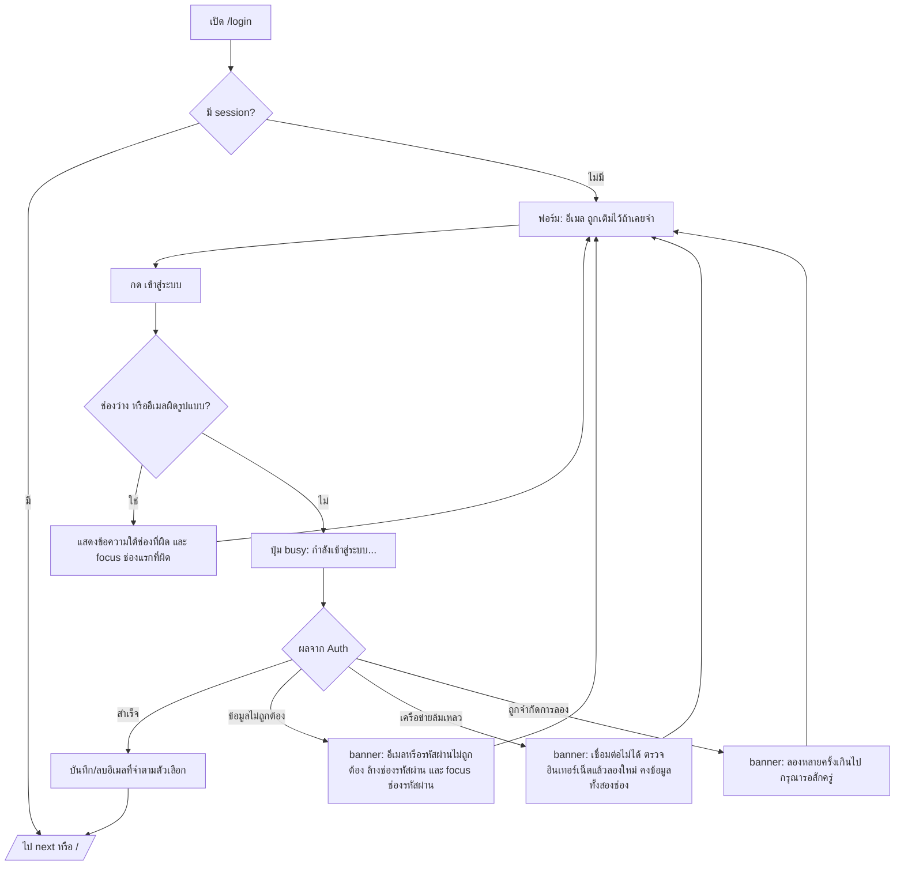
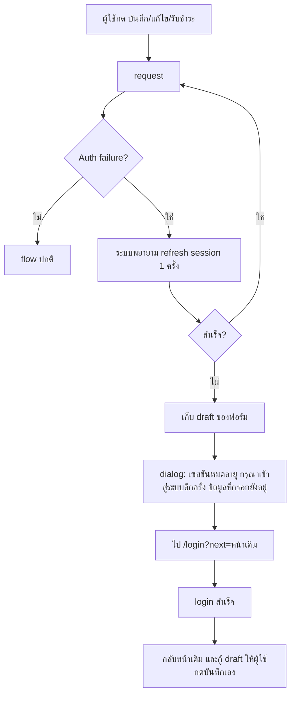
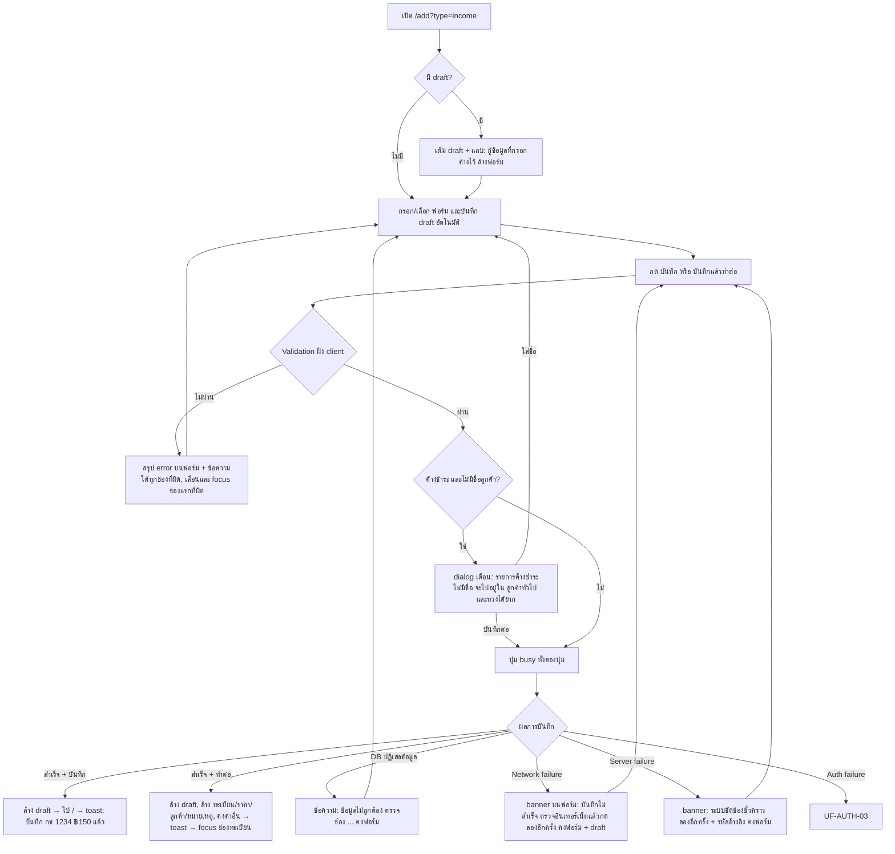
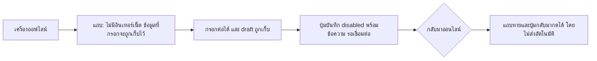
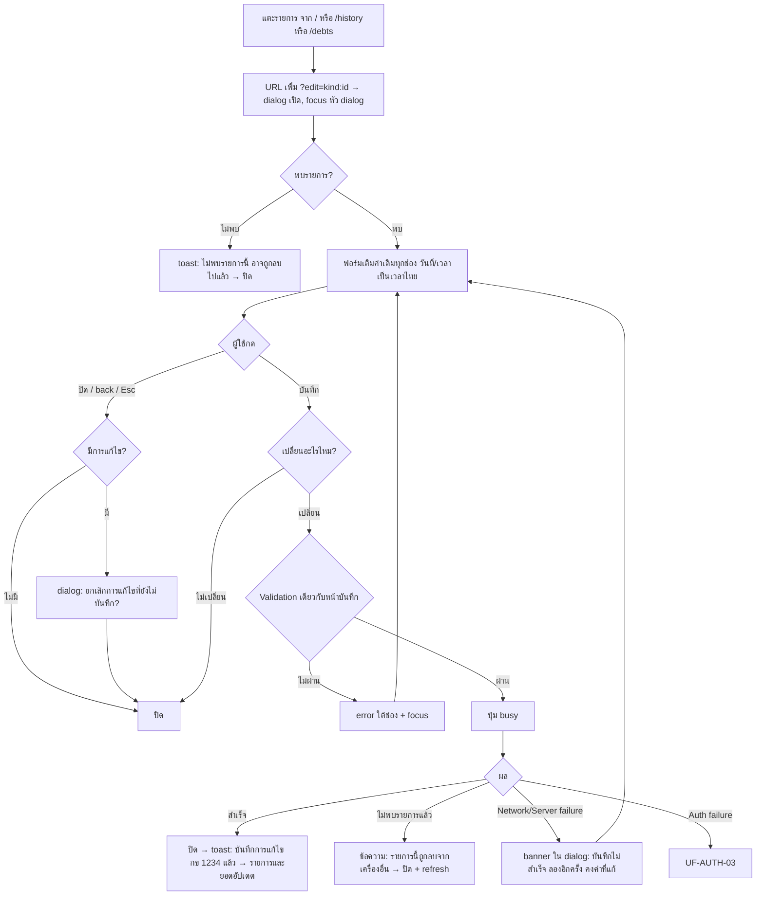
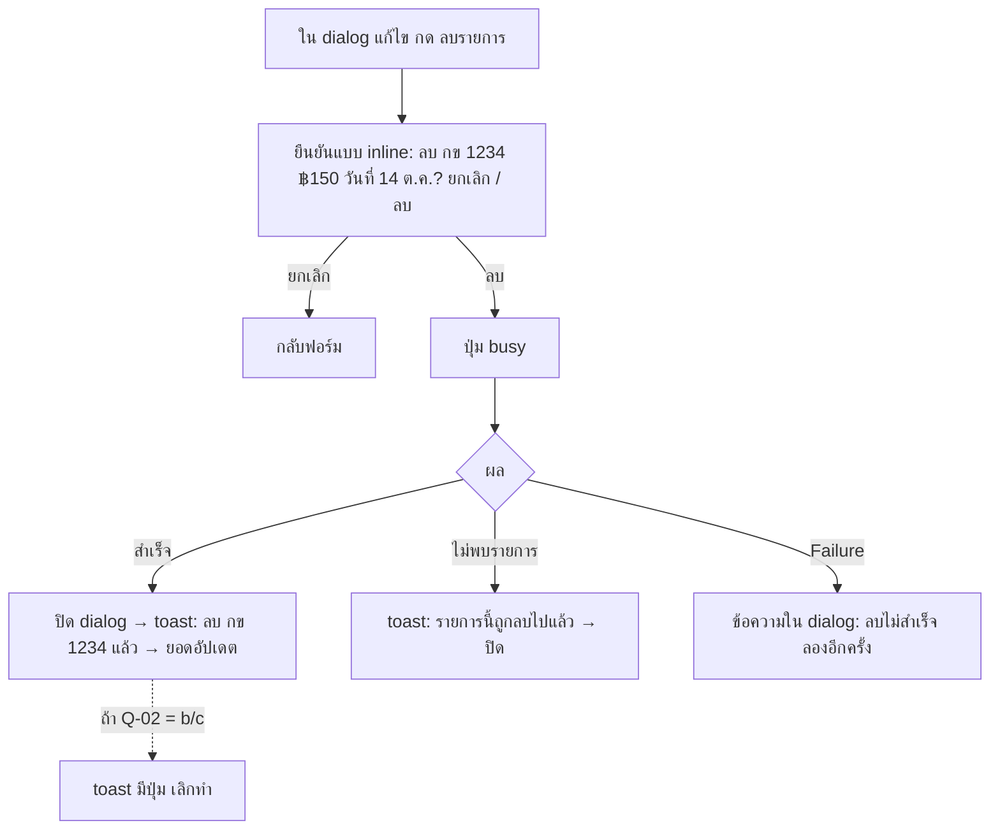
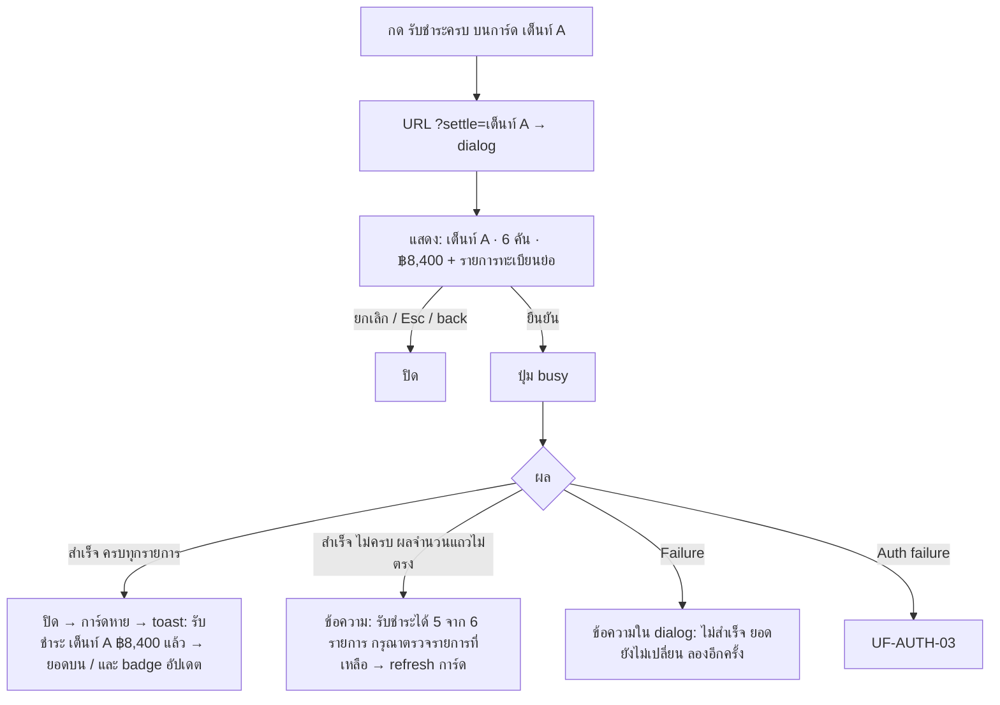
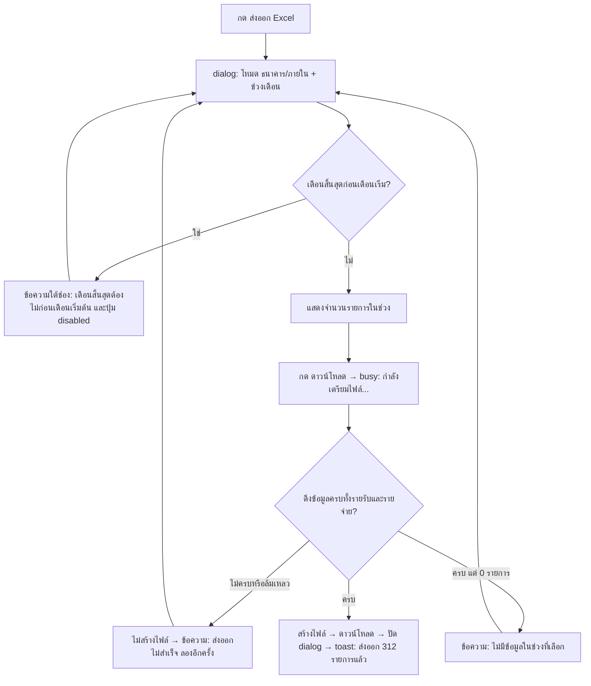

# User Flows — Step 03

> วันที่: 2026-10-14 · ทุก flow มี 3 เส้นทาง: **Success**, **Validation error** และ **Failure recovery**
> แผนภาพใช้ Mermaid (GitHub render ได้) ข้อความบนจอในเอกสารนี้เป็น **ร่าง** ที่ Step 04 ปรับถ้อยคำได้ แต่ต้องคงความหมาย
> รูปแบบ feedback (toast, banner, dialog) นิยามใน `interaction-specifications.md` §3

## 0. สัญลักษณ์และกติการ่วม

- **Network failure** = request ไม่ถึง server หรือ timeout (> 15 วินาที †)
- **Server failure** = server ตอบ error (5xx, PostgREST error) ที่ไม่ใช่เรื่องสิทธิ์
- **Auth failure** = session หมดอายุหรือไม่ถูกต้อง (401 หรือ RLS ปฏิเสธเพราะไม่มี `auth.uid()`)
- ทุก failure: **ข้อมูลที่ผู้ใช้กรอกต้องไม่หาย**, ข้อความต้องเป็นภาษาไทย และต้องมีทางไปต่อ (ลองใหม่, ยกเลิก หรือเข้าสู่ระบบใหม่)
- ทุกการเขียนข้อมูลต้องกดได้ครั้งเดียวต่อการกระทำ (ปุ่มเข้าสถานะ busy)

---

## 1. Authentication & Permission Flows

### UF-AUTH-01 — Login

- ข้อความ "ข้อมูลไม่ถูกต้อง" ใช้ข้อความเดียวกันทั้งกรณีอีเมลไม่มีและรหัสผิด (AC-01-2)
- **ลืมรหัสผ่าน:** ข้อความคงที่ "ติดต่อผู้ดูแลร้านเพื่อตั้งรหัสผ่านใหม่" (Q-15 ค่าเริ่มต้น) และไม่มี flow อีเมล

### UF-AUTH-02 — Route guard

| เงื่อนไข | ผล |
|---|---|
| ไม่มี session + route auth | redirect `/login?next=<path+query>` |
| มี session + `/login` | redirect `/` |
| มี session + route auth | แสดงหน้า |
| `next` ไม่ใช่ path ภายใน | ไม่สนใจ และไป `/` |

### UF-AUTH-03 — Session หมดอายุระหว่างใช้งาน

- **ห้ามส่ง request ซ้ำอัตโนมัติหลัง login ใหม่** เพราะผู้ใช้ต้องเห็นและกดยืนยันเอง (กันรายการซ้ำ)

### UF-AUTH-04 — Logout

`/more` หรือ sidebar → "ออกจากระบบ" → dialog "ออกจากระบบบัญชี x@…?" [ยกเลิก] [ออกจากระบบ] → ล้าง session และ draft ของบัญชีนี้ → `/login` (อีเมลยังจำไว้ถ้าเลือกไว้)
**Failure:** ถ้าเรียก sign-out ไม่สำเร็จ (เน็ตหลุด) ยังต้องล้าง session ฝั่งเครื่องและไป `/login` แล้วแสดง toast "ออกจากระบบในเครื่องนี้แล้ว"

### UF-PERM-01 — Permission boundaries

| ผู้ใช้ | หน้า | ข้อมูล | การกระทำ | เมื่อถูกปฏิเสธ |
|---|---|---|---|---|
| Anonymous | `/login`, not-found, error | ไม่มี (RLS ปฏิเสธทั้งหมด NFR-SEC-01) | login | redirect `/login` |
| Authenticated (ทุกบัญชีเท่ากัน D-08, Q-01 ค่าเริ่มต้น) | ทุก route | อ่าน/เขียน `records`, `expenses` | ทั้งหมด | — |
| Authenticated แต่ DB ปฏิเสธ (เช่น policy เปลี่ยน, บัญชีถูกปิด) | — | — | — | ข้อความ "บัญชีนี้ไม่มีสิทธิ์ทำรายการนี้ กรุณาติดต่อผู้ดูแลร้าน" และ **ไม่** redirect ไป login แล้วรายงานไป monitoring |

> UI ไม่ซ่อนหรือแสดงปุ่มตาม role ใน MVP เพราะไม่มี role ถ้า Q-01 = b ภายหลัง ให้เพิ่มคอลัมน์ role ในตารางนี้ และใช้หลัก "ซ่อนปุ่มที่ทำไม่ได้ + DB ปฏิเสธเสมอ" (ห้ามใช้ UI แทน authorization)

---

## 2. Recording Flows (`/add`)

### UF-REC-01 — บันทึกรายรับ (Success + Validation + Failure)

- **D1–D2 เป็นคำเตือน ไม่ใช่การบังคับ:** ไม่เปลี่ยน rule เพราะชื่อยังไม่บังคับตาม FR-REC-02 (แก้ PP-09) จึงต้องอยู่ในการทดสอบกับผู้ใช้ (S03-02)
- **Network failure ที่ไม่รู้ผล** (timeout หลังส่งไปแล้ว): ระบบตรวจก่อนว่ารายการถูกบันทึกไปแล้วหรือไม่ก่อนให้ลองใหม่ เพื่อกันรายการซ้ำ วิธีตรวจ (เช่น idempotency key) ให้ Step 05 ออกแบบ (S03-04)

### UF-REC-02 — ข้อความ validation (ตามกติกาเดิม FR-REC-02/03)

| ช่อง | เงื่อนไข | ข้อความ (ร่าง) | เมื่อไรแสดง |
|---|---|---|---|
| ทะเบียน | ว่าง | กรุณากรอกป้ายทะเบียน | กดบันทึก หรือออกจากช่องหลังเคยกดบันทึกแล้ว |
| ทะเบียน | > 20 ตัวอักษร | ป้ายทะเบียนยาวเกิน 20 ตัวอักษร | ขณะพิมพ์ (นับตัวอักษร) |
| ประเภทรถ | ไม่ได้เลือก | กรุณาเลือกประเภทรถ | กดบันทึก |
| ราคา | ว่าง | กรุณากรอกราคา | กดบันทึก |
| ราคา | ไม่ใช่จำนวนเต็ม ≥ 0 | กรอกได้เฉพาะตัวเลข (ป้องกันที่ input) | ขณะพิมพ์ (ไม่รับอักขระอื่น) |
| ชื่อลูกค้า | > 50 | ชื่อยาวเกิน 50 ตัวอักษร | ขณะพิมพ์ |
| หมายเหตุ | > 200 | หมายเหตุยาวเกิน 200 ตัวอักษร | ขณะพิมพ์ |
| จำนวนเงินรายจ่าย | ว่างหรือ 0 | กรุณากรอกจำนวนเงินมากกว่า 0 | กดบันทึก |
| รายการจ่าย | ว่าง / > 100 | กรุณาระบุรายการจ่าย / ยาวเกิน 100 ตัวอักษร | กดบันทึก / ขณะพิมพ์ |
| วันที่ | อนาคต | — (ไม่บล็อก เพราะไม่มี rule เดิม) แต่แสดงป้าย "วันที่ในอนาคต" | ทันที |

> ราคา 0 บาท **บันทึกได้** ตามกติกาเดิม (`min(0)`) และยังไม่ตั้ง rule ใหม่

### UF-REC-03 — บันทึกรายจ่าย
เหมือน UF-REC-01 โดยไม่มีขั้น D1–D2 และ "บันทึกแล้วทำต่อ" ล้างทุกช่อง (คงเดิม `resetExpenseForm`) ยกเว้นวันที่

### UF-REC-04 — Offline ขณะอยู่หน้าบันทึก

ไม่มี offline queue (นอก scope: `scope-and-exclusions.md`)

### UF-REC-05 — Draft
- เก็บอัตโนมัติขณะกรอก แยกตามบัญชีและโหมด (รายรับ/รายจ่าย) ใน storage ของแท็บ และอยู่รอดการ reload กับ pull-to-refresh (AC-12-1)
- ถูกล้างเมื่อ: บันทึกสำเร็จ, ผู้ใช้กด "ล้างฟอร์ม" หรือ logout
- ไม่ข้ามอุปกรณ์หรือบัญชี

---

## 3. Edit & Delete Flows

### UF-EDIT-01 — แก้ไขรายการ

- **ส่งเฉพาะ field ที่เปลี่ยน** (E) เพื่อให้ค่าที่ไม่ได้แก้ไม่ถูกเขียนทับ ซึ่งเป็นการป้องกันชั้นที่สองของ ER-01 (AC-26-1)
- การแก้พร้อมกันจาก 2 เครื่อง: MVP ใช้ last-write-wins (เหมือนเดิม) ส่วนการตรวจ conflict (เทียบ `updated_at`) เป็นข้อเสนอสำหรับ Step 05 (S03-04)

### UF-DEL-01 — ลบรายการ

- ปุ่ม "ลบ" ในขั้นยืนยัน **ไม่ใช่ปุ่มที่ได้ focus เริ่มต้น** (focus อยู่ที่ "ยกเลิก")

---

## 4. Debt Flows (`/debts`)

### UF-DEBT-01 — ดูและเรียง
โหลด → สรุปยอด + การ์ดลูกค้า (เรียงตามยอด) → เปลี่ยนเรียงเป็น "ค้างนานสุด" (`?sort=age`)
**Empty:** "ไม่มีรายการค้างชำระ 🎉" · **Failure:** banner + ลองใหม่ (ไม่แสดงยอด 0 ที่ทำให้เข้าใจผิดว่าไม่มีหนี้)

### UF-DEBT-02 — รับชำระครบ

- **ไม่ใช้ optimistic update** สำหรับ action นี้ (เดิมลบการ์ดก่อนรู้ผล) เพราะเป็นข้อมูลเงิน การ์ดจะหายเมื่อยืนยันผลแล้วเท่านั้น
- จำนวนรายการที่ยืนยันใน dialog = จำนวนรายการที่ถูก update จริง (AC-22-2) และถ้าไม่ตรงต้องแจ้ง (G)
- ไม่มีการเคลียร์บางรายการ (D-14)

### UF-BILL-01 — สร้างบิล
กด "สร้างบิล" → ปุ่ม busy "กำลังสร้าง…" → ดาวน์โหลด PDF → toast "สร้างบิล เต็นท์ A แล้ว (เลขที่ …)"
**Failure:** toast error ที่ค้างจนปิด "สร้างบิลไม่สำเร็จ ลองอีกครั้ง" และบิลไม่ได้ใช้เลขที่ (ถ้า Q-05 = b ต้องไม่ใช้เลขเมื่อสร้างไม่สำเร็จ)
**iOS Safari:** ต้องตรวจว่าการดาวน์โหลด PDF เปิด preview แล้วแชร์หรือบันทึกได้ (S03-05)

---

## 5. Dashboard & History Flows

### UF-DASH-01 — โหลดภาพรวม (progressive)

| ส่วน | โหลด | ถ้าล้มเหลว |
|---|---|---|
| เงินสดสุทธิ + สถิติวันนี้ | ก่อนอื่น | การ์ด error "โหลดยอดวันนี้ไม่สำเร็จ" + ลองใหม่ (ห้ามแสดง ฿0) |
| ค้างชำระ | พร้อมกัน | การ์ด error เล็ก + ลองใหม่ |
| รายการวันนี้ | พร้อมกัน | error + ลองใหม่ |
| แนวโน้ม, ลูกค้า | หลังส่วนบน | error ในการ์ดของตัวเอง |
| อากาศ | อิสระ | ซ่อนแถบอากาศ แต่หน้าอื่นใช้ได้ (AC-19-2) |

**Realtime:** ถ้าการเชื่อมต่อ realtime หลุด สถานะ header แสดง "ไม่ได้อัปเดตอัตโนมัติ · แตะเพื่อรีเฟรช" และเชื่อมใหม่อัตโนมัติ เมื่อกลับมาที่แท็บ (visibility) ให้ refresh ข้อมูลวันนี้

### UF-HIST-01 — ค้นหาและกรอง
เปลี่ยนเดือน/ปี → โหลดใหม่ (skeleton เฉพาะรายการ) → ตัวกรองอื่นกรองฝั่งเครื่องทันที (debounce การพิมพ์ค้นหา 250ms †) และ URL อัปเดตแบบ replace (ไม่สร้าง history ทุกตัวอักษร)
**Empty (ไม่มีข้อมูลในเดือน):** "ไม่มีรายการในเดือน ต.ค. 2569" · **Empty (ตัวกรองไม่เจอ):** "ไม่พบรายการที่ตรงกับ 'กข 99'" + ปุ่ม "ล้างตัวกรอง"
**Failure:** banner บนรายการ + ลองใหม่ (ห้ามแสดงยอด 0)

### UF-EXP-01 — ส่งออก Excel

